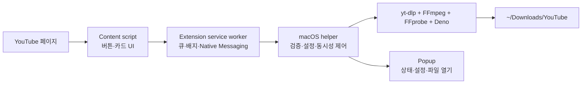

# ClipFlux

ClipFlux는 공개 YouTube watch 페이지의 비디오와 오디오를 macOS에 저장하는 Chrome Manifest V3 확장 프로그램과 로컬 macOS helper입니다. 확장 프로그램은 YouTube 화면과 다운로드 진행 상태를 표시하고, 실제 파일 작업은 별도 helper가 담당합니다.

> 다운로드 권한이 있는 미디어만 저장하세요. 이 프로젝트는 DRM, 로그인·쿠키, 유료/보호 콘텐츠, 접근 제어를 우회하지 않습니다.

## 사용자 기능

- watch 페이지의 **Video** / **Audio** 버튼으로 다운로드 시작
- 홈·검색·추천·재생목록 카드의 썸네일 우측 하단 버튼으로 다운로드 시작
- 최대 2개 동시 다운로드와 최대 20개 대기열
- 팝업에서 대기열, 진행률, 저장 폴더, 비디오 품질, 오디오 포맷 확인 및 변경
- 완료된 팝업 항목을 클릭해 macOS 기본 앱으로 파일 열기
- 다운로드 중 확장 아이콘 상태 변경, 완료 파일 수 배지 표시, 팝업을 열면 배지 초기화
- yt-dlp 업데이트 확인 및 업데이트

기본 저장 위치는 `~/Downloads/YouTube`입니다. Video와 Audio는 기본적으로 각각 `Video`, `Audio` 하위 폴더에 저장됩니다.

## 시스템 설계

브라우저 페이지는 신뢰할 수 없는 입력으로 취급합니다. 다운로드 URL 검증, 파일 경로 결정, 프로세스 실행은 모두 helper에서만 수행합니다.



| 구성 요소 | 책임 |
| --- | --- |
| Chrome extension | YouTube UI 주입, 다운로드 큐 표시, 설정 UI, 확장 아이콘 상태 |
| Service worker | 브라우저 메시지 검증, in-memory 큐, native helper 연결, 이벤트 브로드캐스트 |
| Native helper | Native Messaging 요청 검증, 설정/폴더 관리, 다운로드 실행과 취소, 파일 열기 |
| Runtime | yt-dlp가 다운로드하고 FFmpeg/FFprobe/Deno가 병합·변환·추출을 지원 |

상세 설계는 [architecture](docs/architecture.md), [Native Messaging](docs/native-messaging.md), [security model](docs/security.md)를 참고하세요.

## 개발 환경 요구 사항

개발자는 다음이 필요합니다.

- macOS, Google Chrome
- Node.js와 pnpm 10
- Bun 1.3 이상
- 처음 한 번의 runtime 다운로드를 위한 인터넷 연결

최종 사용자는 Node.js, pnpm, Bun, Python, Homebrew, yt-dlp 또는 FFmpeg를 설치할 필요가 없습니다. 서명·공증된 `.pkg` 하나로 설치합니다.

## 빠른 시작: 로컬 개발

### 1. 의존성과 runtime 준비

```bash
pnpm install
pnpm runtime:download
```

`runtime:download`는 검증된 yt-dlp, Deno, FFmpeg, FFprobe를 `~/Library/Application Support/LocalDownloader/runtime`에 준비합니다.

### 2. Chrome 확장 프로그램 빌드

```bash
pnpm extension:build
```

빌드 결과는 [dist/chrome-extension](/Users/marco/Documents/projects/youtube-downloader/dist/chrome-extension)에 생성됩니다.

1. Chrome에서 `chrome://extensions`를 엽니다.
2. **개발자 모드**를 켭니다.
3. **압축해제된 확장 프로그램을 로드합니다**를 클릭합니다.
4. `dist/chrome-extension` 폴더를 선택합니다.
5. 화면에 보이는 확장 프로그램 ID를 복사합니다.

### 3. macOS helper 빌드 및 Chrome 등록

```bash
pnpm helper:build
LOCAL_DOWNLOADER_EXTENSION_ID=<Chrome 확장 ID> pnpm native:install
```

예시:

```bash
LOCAL_DOWNLOADER_EXTENSION_ID=abcdefghijklmnopabcdefghijklmnop pnpm native:install
```

`native:install`은 Chrome의 사용자별 Native Messaging manifest를 `~/Library/Application Support/Google/Chrome/NativeMessagingHosts/com.localdownloader.helper.json`에 만듭니다.

마지막으로 `chrome://extensions`에서 확장을 새로고침하고 YouTube 탭도 새로고침하세요. 확장 팝업에 **Ready**가 보이면 설치가 완료된 것입니다.

### 4. 로컬 동작 확인

1. 공개 `https://www.youtube.com/watch?v=...` 페이지를 엽니다.
2. 메타데이터 영역의 **Video** 또는 **Audio** 버튼을 클릭합니다.
3. 또는 영상 카드 썸네일 우측 하단의 아이콘을 클릭합니다.
4. 팝업을 열어 다운로드 진행률과 큐를 확인합니다.
5. 완료된 큐 항목을 클릭해 저장 파일이 열리는지 확인합니다.

## 실행 명령어 레퍼런스

| 명령어 | 결과 | 주 사용처 |
| --- | --- | --- |
| `pnpm install` | workspace 의존성 설치 | 최초 개발 환경 설정 |
| `pnpm dev` | extension과 helper 개발 watcher 실행 | UI와 helper를 함께 개발할 때 |
| `pnpm extension:dev` | WXT 개발 watcher 실행 | 확장 프로그램만 개발할 때 |
| `pnpm extension:build` | `dist/chrome-extension` 생성 | unpacked Chrome 확장 빌드 |
| `pnpm extension:package` | `dist/ClipFlux-extension-<version>.zip` 생성 | Chrome Web Store 업로드 |
| `pnpm helper:dev` | `LOCAL_DOWNLOADER_DEV=1` helper watcher 실행 | helper 개발 |
| `pnpm helper:build` | `dist/local-downloader-helper` standalone binary 생성 | Native host 또는 installer 준비 |
| `pnpm runtime:download` | managed runtime 다운로드 및 검증 | 개발/릴리스 runtime 준비 |
| `LOCAL_DOWNLOADER_EXTENSION_ID=<id> pnpm native:install` | 사용자별 Chrome native host 등록 | 로컬 개발 설치 |
| `pnpm native:uninstall` | 사용자별 native host 등록 해제 | 로컬 개발 정리 |
| `pnpm lint` | ESLint 검사 | 변경 전후 품질 확인 |
| `pnpm typecheck` | root와 모든 workspace TypeScript 검사 | 변경 전후 품질 확인 |
| `pnpm test` | Vitest 테스트 실행 | 변경 전후 품질 확인 |
| `pnpm build` | workspace build/typecheck 실행 | 일반 빌드 검증 |
| `LOCAL_DOWNLOADER_EXTENSION_ID=<id> pnpm release:preflight:macos` | 인증서, 공증 프로필, 확장 ID 검사 | 공개 릴리스 직전 |
| `LOCAL_DOWNLOADER_EXTENSION_ID=<id> pnpm release:macos` | 검사, runtime 준비, 서명, 공증, staple, Gatekeeper 검증 | macOS 공개 installer 생성 |

## Chrome Web Store 업로드

### 업로드 ZIP 생성 명령

```bash
pnpm extension:package
```

생성 파일:

```text
dist/ClipFlux-extension-0.1.0.zip
```

이 ZIP은 `manifest.json`이 ZIP 루트에 있으며 Chrome Web Store 업로드 형식으로 검증됩니다.

### 첫 번째 업로드: ID 예약용 초안

Native Messaging installer는 Chrome Web Store의 **고정 확장 ID**를 허용 목록에 넣어야 합니다. 따라서 macOS installer를 공개하기 전에 Web Store 초안을 먼저 만듭니다.

1. [Chrome Developer Dashboard](https://chrome.google.com/webstore/devconsole/)에서 **Add new item**을 누릅니다.
2. `dist/ClipFlux-extension-0.1.0.zip`을 업로드합니다.
3. 아직 **Submit for Review**는 누르지 않습니다.
4. 생성된 **Item ID**를 복사합니다.
5. **Package** 탭의 **View public key**에서 public key를 복사합니다.

공개 key는 비밀 정보가 아닙니다. `manifest.key`에 넣으면 로컬 unpacked 확장 ID와 Web Store ID를 일치시킬 수 있습니다. key 또는 installer URL을 반영해 새 ZIP을 올릴 때는 manifest 버전을 반드시 증가시켜야 합니다.

### 공개 ZIP 생성

공개 installer를 HTTPS에 업로드한 뒤, public key와 installer URL을 포함해 확장을 다시 빌드합니다.

```bash
WXT_EXTENSION_KEY='<Chrome Web Store public key>' \
WXT_INSTALLER_URL='https://downloads.example.com/ClipFlux-arm64.pkg' \
pnpm extension:package
```

`WXT_EXTENSION_KEY`는 manifest에 포함되어 로컬 unpacked 확장 ID를 Web Store Item ID와 일치시킵니다. 새 ZIP을 업로드할 때는 root `package.json` 버전을 증가시키면 manifest 버전도 함께 증가합니다.

## macOS installer 서명·공증

공개 사용자는 pnpm 명령이 아니라 서명·공증된 `.pkg`를 설치합니다.

### 사전 조건

- Apple Developer Program 계정
- Keychain에 **Developer ID Application** 인증서
- Keychain에 **Developer ID Installer** 인증서
- Apple 공증용 app-specific password 또는 App Store Connect API key
- Chrome Web Store의 실제 Item ID. 로컬 unpacked 확장 ID를 사용하면 안 됩니다.

한 번만 공증 자격 증명을 Keychain에 저장합니다. 비밀번호는 명령 실행 중 macOS 프롬프트에만 입력합니다.

```bash
xcrun notarytool store-credentials LocalDownloader \
  --apple-id '<Apple ID 이메일>' \
  --team-id '<Apple Developer Team ID>'
```

### preflight와 릴리스

```bash
LOCAL_DOWNLOADER_EXTENSION_ID=<Chrome Web Store Item ID> pnpm release:preflight:macos
LOCAL_DOWNLOADER_EXTENSION_ID=<Chrome Web Store Item ID> pnpm release:macos
```

`release:macos`는 다음을 순서대로 실행합니다.

1. 인증서, Keychain 공증 프로필, 확장 ID 검증
2. lint, typecheck, 테스트
3. runtime 다운로드, helper 빌드
4. helper와 4개 runtime 실행 파일에 Developer ID Application + hardened runtime 서명
5. `ClipFlux-arm64.pkg` 또는 `ClipFlux-x64.pkg`에 Developer ID Installer 서명
6. Apple 공증 제출 및 대기
7. 공증 ticket staple과 Gatekeeper `spctl` 검증

완료된 installer는 `dist/ClipFlux-arm64.pkg` 또는 `dist/ClipFlux-x64.pkg`에 생성됩니다. 이 파일을 HTTPS로 호스팅하고 `WXT_INSTALLER_URL`에 그 주소를 넣어 공개 확장 ZIP을 다시 만드세요.

릴리스 전후 확인 항목은 [macOS release checklist](docs/release-checklist.md)에 있습니다. 패키지 payload와 runtime 설계는 [packaging](docs/packaging.md)을 참고하세요.

## 설정 레퍼런스

| 항목 | 기본값 | 설명 |
| --- | --- | --- |
| Video quality | `best-up-to-1080p` | MP4 선호, 최대 1080p의 최적 비디오/오디오 조합 |
| Video container | `mp4` | 현재 MP4만 지원 |
| Audio format | `original` | 원본 최적 오디오. M4A 또는 MP3 선택 가능 |
| MP3 bitrate | `320 kbps` | MP3 선택 시 320/256/192 kbps |
| Save location | `~/Downloads/YouTube` | 팝업의 **Change…**에서 변경 |
| Separate folders | `true` | Video와 Audio를 분리된 하위 폴더에 저장 |
| Automatic yt-dlp updates | `true` | helper 시작 시 yt-dlp 최신 버전 확인 |
| Show Video / Audio button | `true` | watch 페이지와 카드의 해당 버튼 노출 여부 |

설정 파일은 `~/Library/Application Support/LocalDownloader/config.json`에 저장됩니다. extension 전용 버튼 노출 설정은 `chrome.storage.local`에 저장됩니다.

## 문제 해결

### `Downloader setup required` 또는 `Native helper disconnected`

1. helper와 runtime을 다시 준비합니다.

   ```bash
   pnpm runtime:download
   pnpm helper:build
   LOCAL_DOWNLOADER_EXTENSION_ID=<현재 Chrome 확장 ID> pnpm native:install
   ```

2. `chrome://extensions`에서 확장을 새로고침합니다.
3. YouTube 탭을 새로고침하고 팝업에서 **Check again**을 누릅니다.

### 카드 아이콘이 보이지 않음

- `chrome://extensions`에서 확장을 새로고침합니다.
- YouTube 페이지를 새로고침합니다.
- 확장 팝업에서 **Show Video button**과 **Show Audio button** 설정을 확인합니다.

### 다운로드는 완료됐지만 파일을 열 수 없음

- 팝업의 완료된 항목은 해당 helper 세션에서 완료된 파일만 엽니다.
- 파일이 Finder에서 이동되거나 삭제되면 열 수 없습니다.
- 저장 경로와 파일 접근 권한을 확인하세요.

### yt-dlp 또는 Python.framework 오류

macOS 환경에 따라 PyInstaller 기반 yt-dlp가 Gatekeeper 문제를 보일 수 있습니다. 이 helper는 `/opt/homebrew/bin/yt-dlp` 또는 `/usr/local/bin/yt-dlp`가 있으면 우선 사용합니다. 개발 환경에서 Homebrew yt-dlp를 사용하는 경우:

```bash
brew install yt-dlp
```

그 후 helper를 다시 시작하거나 Chrome 확장을 새로고침하세요.

## 보안과 제한 사항

- 허용 대상은 `https://www.youtube.com/watch?v=<11자 ID>` 형식의 공개 watch URL뿐입니다.
- Native helper는 raw command, raw argument, 브라우저 제공 경로, shell 실행을 허용하지 않습니다.
- 다운로드 프로세스는 shell 없이 고정된 allowlist 인수로 실행됩니다.
- 최대 동시 다운로드는 2개이고, 대기열은 20개까지입니다.
- macOS와 Google Chrome만 지원합니다.
- 플레이리스트 일괄 다운로드, Shorts 일괄 다운로드, 로그인/쿠키, 자막 다운로드는 지원하지 않습니다.

더 자세한 위협 모델과 입력 검증 규칙은 [security model](docs/security.md)을 참고하세요.
