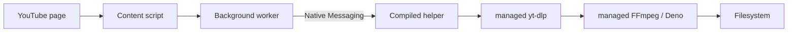
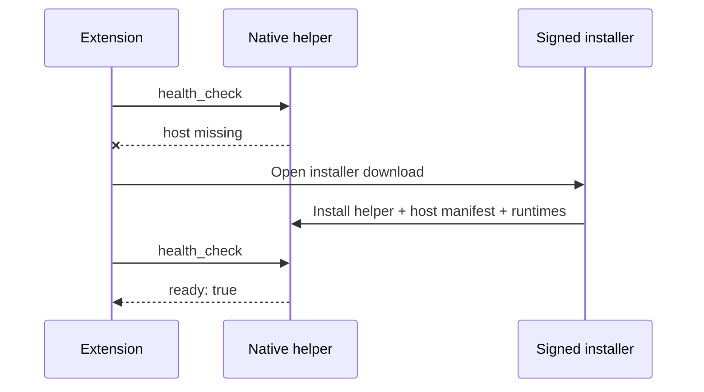
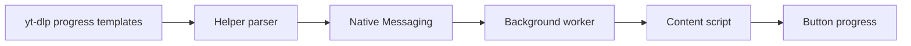

# Architecture

## Responsibilities

The content script owns page UI only. The service worker is the sole Native Messaging client. The helper is the trust boundary: it validates the URL and structured settings, chooses filesystem paths, limits concurrency, and maps settings to fixed process arguments. Helper configuration lives at `~/Library/Application Support/LocalDownloader/config.json`; extension-only visibility preferences live in `chrome.storage.local`.

### Download flow

### Initial installation

### Progress events

Each task has a UUID independent of video ID and kind. This allows video and audio downloads for the same watch page to proceed independently. Page identity remains the canonical video ID so SPA navigation cannot apply a new click to the previous video.

The native connection is long-lived while Chrome holds the service worker/popup connection. yt-dlp emits prefixed machine-readable progress and after-move lines. The helper translates these to typed events and never forwards raw output.

